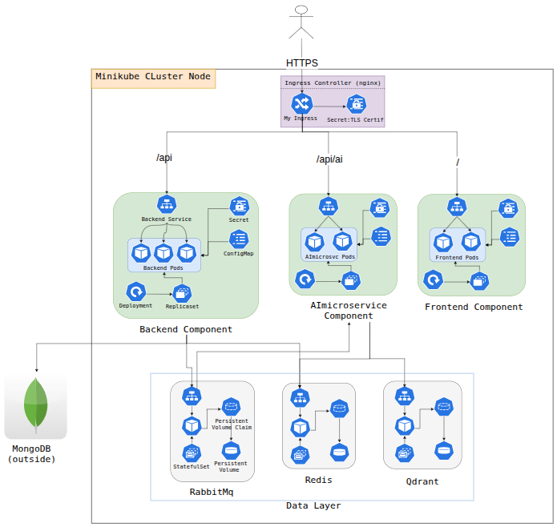

# Samsar Microservices Platform (Minikube)



A multi-tier microservices application deployed on **Minikube** inside the **`samsar`** Kubernetes namespace.

---

## ⚡ Quick Start

```bash
# 1. Start Minikube & Enable Ingress
minikube start --driver=docker
minikube addons enable ingress

# 2. Create Namespace & Deploy Infrastructure (Redis, RabbitMQ, Qdrant)
kubectl apply -f microservices/namespace.yml
kubectl apply -f microservices/redis/
kubectl apply -f microservices/rabbitmq/
kubectl apply -f microservices/qdrant/

# 3. Create TLS & Application Secrets
mkcert samsarpromax.local.com
kubectl create secret tls samsar-tls \
  --cert=samsarpromax.local.com.pem \
  --key=samsarpromax.local.com-key.pem \
  -n samsar

kubectl apply -f microservices/backend/backend-secret.yml
kubectl apply -f microservices/aimicroservice/aimicroservice-secret.yml
kubectl apply -f microservices/frontend/frontend-secret.yml

# 4. Deploy Microservices & Ingress Rules
kubectl apply -f microservices/backend/
kubectl apply -f microservices/aimicroservice/
kubectl apply -f microservices/frontend/
kubectl apply -f microservices/ingress.yml

# 5. Map Host Domain (/etc/hosts)
echo "$(minikube ip) samsarpromax.local.com" | sudo tee -a /etc/hosts
```

---

## 📦 Services Overview

| Component | Kind | Replicas | Port | Ingress Path | Description |
| :--- | :--- | :---: | :---: | :--- | :--- |
| **Frontend** | Deployment | 2 | `8080` | `/` | Web UI |
| **Backend** | Deployment | 3 | `4001` | `/api` | REST API (connects to external MongoDB) |
| **AI Microservice** | Deployment | 2 | `8000` | `/api/ai` | ML Models & LLM Inference |
| **RabbitMQ** | StatefulSet | 1 | `5672` | Internal | Message Queue (2Gi PVC) |
| **Redis** | StatefulSet | 1 | `6379` | Internal | Cache (2Gi PVC) |
| **Qdrant** | StatefulSet | 1 | `6333` | Internal | Vector Database (3Gi PVC) |

---

## 🌐 Endpoints

- **Web App**: `https://samsarpromax.local.com/`
- **Backend API**: `https://samsarpromax.local.com/api`
- **AI Microservice**: `https://samsarpromax.local.com/api/ai`

---

## 🔍 Quick Inspection

```bash
# Check all resources
kubectl get all,pvc,ingress -n samsar

# Stream logs
kubectl logs -n samsar -l app=backend-pod-label -f
kubectl logs -n samsar -l app=aimicroservice-pod-label -f
```
